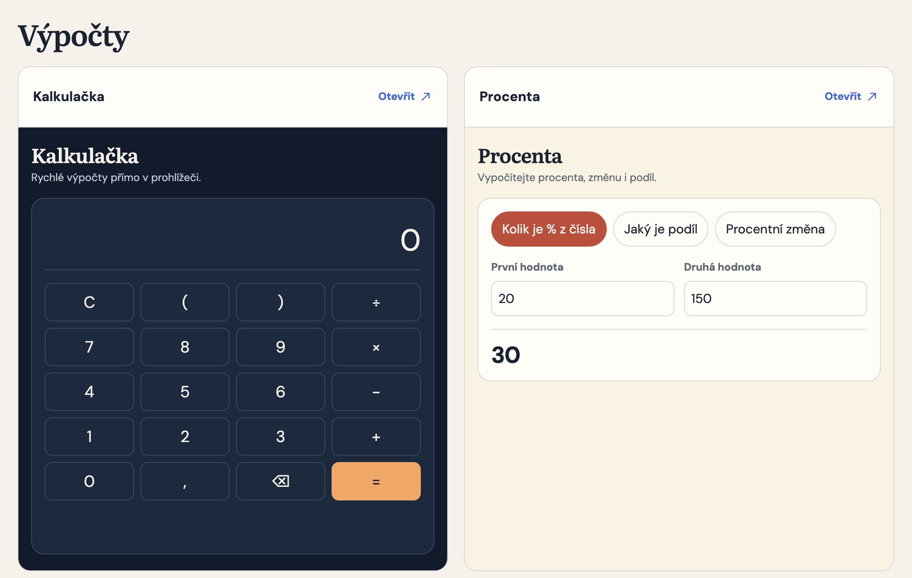

<p align="center">
  <a href="https://nastroje.indigostudio.cz"></a>
</p>

<h1 align="center">Online nástroje</h1>

<p align="center">
  35 small, free online tools by <a href="https://indigostudio.cz">Indigo Studio</a>, each on its own subdomain.<br>
  No sign-up, no ads, no tracking. Everything runs in your browser.
</p>

<p align="center">
  <a href="https://nastroje.indigostudio.cz"><strong>nastroje.indigostudio.cz</strong></a>
  &nbsp;·&nbsp;
  <a href="https://github.com/IndigoStudioCZ/nastroje/actions/workflows/ci.yml"></a>
</p>

The tools speak Czech and cover everyday jobs: calculations, conversions, money, dates, text, images and a few browser and device checks. The overview at [nastroje.indigostudio.cz](https://nastroje.indigostudio.cz) shows every tool as a live preview, so you can use it without leaving the page. A directory of Czech public and commercial online services comes along at [ceska-republika.indigostudio.cz](https://ceska-republika.indigostudio.cz).

## The tools

| Group | Tool | What it does |
| --- | --- | --- |
| **Directories** | [Česká republika](https://ceska-republika.indigostudio.cz) | Czech government services, health and commercial insurers, transport, carriers and streaming in one place |
| **Calculations** | [Kalkulačka](https://kalkulacka.indigostudio.cz) | Quick calculations right in the browser |
| | [Procenta](https://procenta.indigostudio.cz) | Percentages, percentage change and ratios |
| | [Trojčlenka](https://trojclenka.indigostudio.cz) | Rule of three, direct and inverse proportion |
| | [DPH](https://dph.indigostudio.cz) | Add or remove Czech VAT |
| | [Spropitné](https://spropitne.indigostudio.cz) | Split the bill and work out the tip |
| **Conversions** | [Převody jednotek](https://prevody-jednotek.indigostudio.cz) | Length, weight, volume, area and temperature |
| | [Převody měn](https://prevody-men.indigostudio.cz) | Indicative currency conversion with ECB reference rates |
| | [Časová pásma](https://casova-pasma.indigostudio.cz) | The time in cities around the world |
| | [Velikosti oblečení](https://velikosti-obleceni.indigostudio.cz) | Indicative conversion of common clothing sizes |
| **Work and money** | [Čistá mzda](https://cista-mzda.indigostudio.cz) | Indicative Czech net salary for 2026 |
| | [Hodinová sazba](https://hodinova-sazba.indigostudio.cz) | Turn a monthly target into an hourly rate |
| | [Fakturace](https://fakturace.indigostudio.cz) | A simple invoice to print or save as PDF |
| | [Úroky](https://uroky.indigostudio.cz) | Simple and compound interest |
| | [Splátky](https://splatky.indigostudio.cz) | Indicative monthly loan repayment |
| **Time and planning** | [Kalendář](https://kalendar.indigostudio.cz) | A clear monthly calendar |
| | [Datum](https://datum.indigostudio.cz) | The difference between two dates, or a date moved by days |
| | [Pracovní dny](https://pracovni-dny.indigostudio.cz) | Working days between two dates |
| | [Odpočet](https://odpocet.indigostudio.cz) | Countdown to a chosen day and time |
| | [Stopky](https://stopky.indigostudio.cz) | A stopwatch with laps |
| | [Časovač](https://casovac.indigostudio.cz) | A timer that alerts you when the time is up |
| **Text and content** | [Počítadlo slov](https://pocitadlo-slov.indigostudio.cz) | Words, characters, sentences and reading time |
| | [Formátování textu](https://formatovani-textu.indigostudio.cz) | Letter case, spaces and line breaks |
| | [QR kód](https://qr-kod.indigostudio.cz) | A QR code for a link or a short text |
| | [Generátor hesel](https://generator-hesel.indigostudio.cz) | Strong passwords generated on your device |
| **Web and files** | [Barvy](https://barvy.indigostudio.cz) | Colors, shades and their HEX, RGB and HSL codes |
| | [Kontrast](https://kontrast.indigostudio.cz) | Readability of two colors against WCAG |
| | [Úpravy obrázku](https://upravy-obrazku.indigostudio.cz) | Rotate, crop, resize or convert an image |
| | [Rozměry obrázku](https://rozmery-obrazku.indigostudio.cz) | Dimensions and aspect ratio of an image |
| | [Komprese obrázku](https://komprese-obrazku.indigostudio.cz) | Make an image smaller |
| | [EXIF fotografií](https://exif.indigostudio.cz) | Read and edit EXIF data in a photo |
| | [Metadata souboru](https://metadata.indigostudio.cz) | Basic details and metadata of any file |
| **Development and devices** | [Převod formátů](https://prevod-formatu.indigostudio.cz) | Convert data between JSON, YAML, CSV, XML and more |
| | [Prohlížeč a zařízení](https://prohlizec.indigostudio.cz) | What your browser knows about your device and which features it supports |
| | [Bluetooth](https://bluetooth.indigostudio.cz) | Scan for Bluetooth LE devices and read their data |
| **Fun** | [Klakson](https://klakson.indigostudio.cz) | Honk like a car, a truck, a train, a ship or a vintage klaxon |

## How it works

- **One Worker, 37 domains.** A single [Cloudflare Worker](https://developers.cloudflare.com/workers/) answers on the overview, every tool and the directory. It picks the page by hostname from [`src/tools-data.js`](src/tools-data.js).
- **Server-rendered shell, tool in the browser.** The Worker fills a shared HTML shell with the tool's title, description, share image and structured data. [`public/tools/app.js`](public/tools/app.js) then builds the tool itself.
- **Live previews.** The overview embeds each tool with `?embed=1`. Only the overview may frame them (`Content-Security-Policy: frame-ancestors`), and the embedded copies are kept out of search results.
- **Private by design.** Files you open in the image, EXIF and metadata tools never leave your device. The only request to the server is the currency converter's exchange rates: the Worker fetches the ECB reference rates and your browser keeps them for an hour.
- **No build step.** Plain HTML, CSS and JavaScript, no frameworks and no runtime dependencies. Wrangler is the only development dependency.

## Run it locally

You need [Node.js](https://nodejs.org) 22 or newer.

```bash
npm install
npm run dev                                             # the overview on http://localhost:8787
npx wrangler dev --local-upstream dph.indigostudio.cz   # one tool, here DPH
npm run check                                           # what CI runs before every deploy
```

`wrangler dev` serves one hostname at a time, and the Worker chooses the page by hostname. The overview embeds the tools from production, so open a single tool with `--local-upstream` while you work on it.

`npm run check` verifies that the domains in `wrangler.toml`, the catalog and the share images match `src/tools-data.js`, checks the syntax of the scripts, and starts the Worker locally on all 37 hostnames.

## Add a tool

1. **[`src/tools-data.js`](src/tools-data.js):** add `[slug, title, description]` to `TOOLS` and put the slug into a group in `TOOL_CATALOG`.
2. **[`public/tools/app.js`](public/tools/app.js):** add a renderer for the slug to the `tools` map.
3. **[`wrangler.toml`](wrangler.toml):** add `{ pattern = "<slug>.indigostudio.cz", custom_domain = true }`.
4. **`npm run og`:** generate the share image `public/tools/og/<slug>.png`. It needs `rsvg-convert` (on macOS `brew install librsvg`).
5. **`npm run check`**, then open a pull request. The deploy creates the DNS record and the certificate for the new subdomain.

## Notes for maintainers

- **Brand colors:** the default accent is Indigo `#2A018A` from the Indigo Studio logo. Tool groups keep their own accents. The mark in the top bar is `public/logo-mark.svg` used as a CSS mask, so it takes the `--brand` color (light indigo `#B899FF` on the dark tools).
- **Čistá mzda** (net salary) covers a standard employment contract in the Czech Republic for 2026. Check the rates and thresholds in `public/tools/app.js` before the next year.
- **Převody měn** shows the date of the ECB reference rates it used. The ECB publishes them on working days.
- **EXIF fotografií** reads and writes JPEG metadata without libraries ([`public/tools/exif.js`](public/tools/exif.js)) and copies the manufacturer's MakerNote unchanged.
- **Bluetooth** relies on Web Bluetooth, which only Chrome and Edge support. The overview allows it in the preview with `allow="bluetooth"`.
- **Layout** follows the width of `.tool` through container queries, not the window, so short fields stay in columns even in a narrow card. Each preview reports its height to the overview with `postMessage`, so the cards grow without scrollbars.
- **The rail** on the right of the overview has a dot for every card (`renderToolNav` in the Worker). Cards have anchors by slug, for example `#klakson`.
- **Česká republika:** after you edit the links in [`src/ceska-republika-data.js`](src/ceska-republika-data.js), check that the target addresses still work.

## Deployment

[GitHub Actions](.github/workflows/ci.yml) runs on every push and pull request:

- **Every push and pull request:** `npm run check` and `wrangler deploy --dry-run`.
- **Push to `main`, including a merged pull request:** `wrangler deploy` to the *production* environment. Deploys run one after another, never in parallel.

Pull requests are merged with **Rebase and merge**. Merge commits and squashing are turned off and `main` requires a linear history.

The deploy job reads two repository secrets: `CLOUDFLARE_ACCOUNT_ID`, and `CLOUDFLARE_API_TOKEN` created from the *Edit Cloudflare Workers* template and limited to the `indigostudio.cz` zone.

## Project structure

```
src/
  worker.js                  routing by hostname, page rendering, exchange rates
  tools-data.js              slugs, titles, descriptions and catalog groups
  tools.page.html            HTML shell shared by the overview and every tool
  ceska-republika-data.js    links in the Czech services directory
  ceska-republika.page.html  the directory page
public/
  tools/app.js               every tool, one renderer per slug
  tools/style.css            shared styles
  tools/qr.js, exif.js, js-yaml.js   code used by single tools
  tools/fonts/               DM Sans and Literata
  tools/og/                  share images, one per subdomain
  ceska-republika/           directory styles and search
scripts/
  check.mjs                  checks run by CI
  generate-tool-og.mjs       regenerates the share images
wrangler.toml                Worker configuration and all 37 domains
```

## Third-party code and fonts

- [QR Code Generator for JavaScript](public/tools/qr.js) by Kazuhiko Arase, [MIT](public/tools/qr-LICENSE.txt). “QR Code” is a registered trademark of DENSO WAVE INCORPORATED.
- [js-yaml 4.3.2](public/tools/js-yaml.js) by Vitaly Puzrin, [MIT](public/tools/js-yaml-LICENSE.txt).
- [DM Sans](public/tools/fonts/dm-sans-LICENSE.txt) and [Literata](public/tools/fonts/literata-LICENSE.txt), SIL Open Font License 1.1.

---

<p align="center">
  Made in Prague by <a href="https://indigostudio.cz">Indigo Studio</a>. The tools started inside the <a href="https://github.com/junkycoder/indigostudio.cz">indigostudio.cz</a> website and moved here with their history.
</p>
